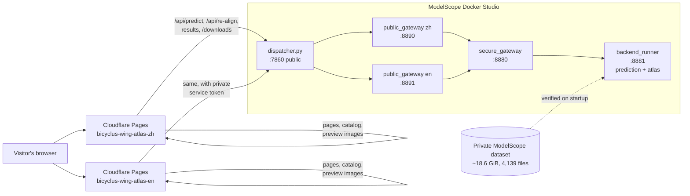

# Bicyclus Wing Atlas

**A web atlas of gene expression in *Bicyclus anynana* wings, plus a tool that tells you which wing and stage your own DAPI image shows.**

[**Project entry**](https://bicycluswingatlas.pages.dev/) · [**Open the English site**](https://bicyclus-wing-atlas-en.pages.dev/) · [**打开中文版**](https://bicyclus-wing-atlas-zh.pages.dev/) · [**English user manual**](https://bicyclus-wing-atlas-en.pages.dev/manual/) · [**中文使用手册**](https://bicyclus-wing-atlas-zh.pages.dev/manual/) · [Deployment guide (中文)](deploy/DEPLOYMENT_ZH.md)

The atlas brings together 291 registered fluorescence images covering 12 genes, two wing families (forewing and hindwing) and three developmental stages (0.5, 0.75 and 1.0). The stage numbers label successive stages of wing development, using existing fluorescence images of fixed wings, with DAPI providing the nuclear reference channel. The project covers computational analysis and platform construction. Each gene, wing and stage combination has been summarized onto a shared 2048 × 2048 reference wing, so patterns can be compared side by side and laid over a standard DAPI image with its confirmed vein layer. You do not need an account to browse the atlas or to run a prediction. Only the original full-resolution images and numerical arrays are behind a download password.

---

## What you can do on the website

The home page offers three workspaces, and each one is linked to the others so you can move between them without losing your place.

**Predict Wing & Stage** (`/en/predict/`). Upload a DAPI image of a single wing, with an optional binary mask. The service finds the wing outline, normalizes its orientation, mirroring, scale and position, and then reports how likely it is to be a forewing or a hindwing and which of the three stages it most resembles. When the result is confident, the site opens the matching atlas for you. When it is not, you are shown all six wing and stage combinations ranked by probability and asked to choose. If the automatic alignment looks wrong, you can rotate, scale, move or flip the wing yourself against a fixed orientation guide and re-run the prediction.

**Gene Expression** (`/en/atlas/`). Pick a gene, a wing and a stage to see its expression as a heatmap on a fixed 0 to 1 scale, or as "intensity particles." You can compare the same gene across the three stages, between forewing and hindwing, or across the three image-processing methods, and you can page through the individual source images that went into each average. All panels zoom and pan together.

**Anatomy & Layers** (`/en/anatomy/`). Start from the standard DAPI image and the confirmed vein layer for any of the six wing and stage references, then add up to four genes as colored overlays. Brightness, opacity, colors, blending and layer order are all adjustable, and three display presets are provided.

Every view has a **Copy view link** button. The link records the gene, wing, stage, processing method and every layer setting, so a colleague who opens it sees exactly what you saw.

For a guided walkthrough with interactive examples (a practice alignment, a decision checker that shows when the atlas opens automatically, and a share-link builder), open the [published English manual](https://bicyclus-wing-atlas-en.pages.dev/manual/). Its source is `public/en/docs/manual.html`; the Chinese guide is `public/zh/docs/manual.html`. Both are ordinary HTML files with no build step. The practice widgets are educational simulations and do not run the trained predictor.

## What is in the atlas

The released dataset contains 12 genes, 291 source images, 72 atlas groups (12 genes × 2 wings × 3 stages), 216 expression representations (each group processed three ways) and six anatomical references (one per wing and stage). The *hth* dataset has been deliberately excluded from this release.

The number of source images behind each group is shown below. Groups with only one image are flagged in the interface as single-sample maps rather than population averages.

| Gene | FW 0.5 | FW 0.75 | FW 1.0 | HW 0.5 | HW 0.75 | HW 1.0 | Total |
|---|---:|---:|---:|---:|---:|---:|---:|
| *dll* | 1 | 10 | 4 | 6 | 9 | 11 | 41 |
| *dpp* | 2 | 4 | 5 | 2 | 1 | 4 | 18 |
| *fz9* | 5 | 5 | 5 | 7 | 5 | 5 | 32 |
| *hh* | 4 | 3 | 4 | 4 | 4 | 1 | 20 |
| *mad6* | 3 | 4 | 3 | 2 | 4 | 1 | 17 |
| *omb* | 4 | 7 | 15 | 11 | 7 | 20 | 64 |
| *optix* | 2 | 2 | 2 | 2 | 3 | 2 | 13 |
| *sal* | 2 | 4 | 6 | 1 | 9 | 9 | 31 |
| *tkv* | 1 | 2 | 5 | 2 | 2 | 2 | 14 |
| *vg* | 1 | 3 | 2 | 1 | 1 | 3 | 11 |
| *wg* | 2 | 3 | 2 | 3 | 2 | 1 | 13 |
| *wnt10* | 1 | 2 | 6 | 2 | 3 | 3 | 17 |
| **All genes** | **28** | **49** | **59** | **43** | **50** | **62** | **291** |

*FW = forewing, HW = hindwing. Counts come from `public/en/data/catalog.json`.*

Each group is available under three processing methods. **Soft gating** (`early_soft_q20`) is the default for browsing; it down-weights low signal-to-noise pixels before the frozen registration is replayed, which cleans up background but can also weaken genuinely faint expression. **Baseline** (`baseline`) is the control with no extra filtering, although historical gain and background handling may already be present, so it is not untouched microscope data. **Bilateral + soft-q20** (`bilateral_soft_q20`) adds edge-preserving smoothing before soft gating. Registration, gain and display scale are identical across the three, so differences between them reflect processing only.

### How to read the images responsibly

Expression values are relative fluorescence, not molecule counts, and intensities are not calibrated across samples or genes. Intensity particles are display samples, not individual transcripts. When genes are overlaid in color, the mixing is qualitative and does not demonstrate co-expression in the same cells. Registration of the gene images is still marked as needing confirmation: 48 groups are "provisional, registration review required" and 24 older groups are "legacy quality accepted, registration experimental." The vein layers are frozen, human-selected representatives and are never re-fitted. The interface repeats these caveats next to the relevant controls.

The retention and coverage numbers shown under "Signal & coverage diagnostics" describe how much signal survived processing and how much of the reference wing is covered. They are not accuracy, precision or recall.

## Understanding a prediction

The predictor combines a wing-type model with a separate stage model for each wing family. Stage evidence is fused from four sources that are shown on the page: the primary model, an ordinal model, template matching, and the nearest manually aligned reference wings. The six "joint" probabilities (two wings × three stages) are the wing probability multiplied by the stage probability for that wing.

A prediction is labeled **auto_candidate**, and the atlas opens automatically, only if all of the following hold: wing probability is at least 0.62, the gap between forewing and hindwing is at least 0.06, the top stage probability is at least 0.48, the gap to the second stage is at least 0.04, the stage model itself returns an automatic decision, the ordinal model does not contradict the fused stage (for example by putting the wing two stages away), and alignment confidence is at least 0.62. If any check fails, the result is labeled **needs_review**, and the reasons are listed (for example `stage_margin_below_0.04`). After a manual alignment the label becomes **manual_candidate** if everything passes, or **needs_review** if, for instance, the wing family you chose disagrees with the wing-type model.

Alignment confidence is a heuristic, not a probability. It is 0.62 × reference overlap + 0.23 × template similarity + 0.15 × mask sanity, where mask sanity rewards a wing that fills roughly a third of the canvas.

Choosing a different atlas combination on the result page changes only what you are looking at. It is not saved as a correction or a training label. Your prediction history is kept private to your browser through a 30-day cookie, and other visitors cannot see your uploads or results.

**Practical limits.** Uploads (image plus mask) may total up to 64 MB. The free cloud backend runs one prediction at a time, so a second submission during a run is turned away with "Another prediction is running." The backend may sleep when idle, in which case the predictor shows "service preparing" for a short while; atlas browsing keeps working regardless because it is served separately.

## Downloading original data

Display images on the site are reduced-resolution previews (longest edge 960 px) and can be viewed and saved freely. Original images, 16-bit intensity PNGs and the NumPy arrays behind each group (`expression_float.npy`, `between_sample_sd.npy`, `coverage_count.npy`, `missing_support.npy`, `outside_reference_conflict.npy`, `points.npz`) are listed at `/downloads/` and require the username `atlas_download` and a password issued by the project owner. Requests for anything not in the published catalog are refused even with the password.

---

## How the system fits together

The project is split so that the public website is static and cheap to host, while the scientific code and private data live on a single backend that the browser never talks to directly.



Each language edition is an independent Cloudflare Pages project. Its `_worker.js` serves the HTML, the atlas catalog and the preview images from bundled "preview packs," and forwards only prediction, result and download requests to the backend. On the backend, `deploy/start.py` installs and SHA-256-verifies the private data bundle, then starts the services in order. Only the dispatcher on port 7860 is exposed; everything else listens on loopback. Visitor isolation is handled by the per-language public gateways, and download passwords are checked by the secure gateway.

## Repository layout

| Path | What it contains |
|---|---|
| `public/en`, `public/zh` | The two Pages sites: HTML, CSS and JavaScript for each workspace, the routing `_worker.js`, the public catalog (`data/catalog.json`) and the preview-pack manifest. **This is the single editable frontend tree for Pages, Docker and local gateways. Edit the UI here.** |
| `code_python/` | The scientific modules: mask extraction, alignment, the wing-type and stage classifiers, template geometry, the prediction server and the atlas server. Prediction algorithms and validated model/data bundles retain the approved scientific workflow. Historical UI assets in this directory are internal compatibility resources, not the active public frontend. |
| `output_results/platform_local_secure_20261019/` | Private backend runner, the password-checking secure gateway and credential handling (`access_control.py`). |
| `output_results/platform_public_bilingual_20261019/` | The anonymous per-language gateways that keep each visitor's predictions separate. |
| `deploy/` | Startup supervisor, data bootstrap and verification, dispatcher, Pages build and check scripts, and the private-data uploader. |
| `tests/prediction-proxy.test.mjs` | Node tests for the Worker's proxying, origin checks, upload framing, error messages and manual routes. Python gateway tests cover local routing and download protection. |
| `.github/workflows/` | `pages.yml` builds and publishes both language sites and the lightweight project entry; `modelscope.yml` pushes backend code to the existing Studio. |
| `Dockerfile`, `compose.yaml` | Container definition for the complete local browser/API service, using the same `public/` frontend as Pages. |

The repository deliberately contains no original arrays, trained model bundles, full-resolution images or credentials. The `.gitignore` and `.dockerignore` files block `*.pkl`, `*.npy`, `*.npz`, `*.pt`, `.env` files and similar.

## Running it yourself

You need the private data bundle (the folder that contains `data_manifest.json`) to run predictions. Without it you can still work on the website itself.

### Backend with Docker

```bash
export ATLAS_DATA_PATH=/path/to/protected_data      # folder containing data_manifest.json (mounted read-only)
export ATLAS_STATE_PATH=/path/to/wing-atlas-state   # writable: credentials, uploads, history, logs
export ATLAS_DOWNLOAD_PASSWORD='a-strong-password'  # optional; leave unset to keep downloads disabled
docker compose up --build
curl http://127.0.0.1:7860/healthz
```

Open `http://127.0.0.1:7860/en/` for English or `http://127.0.0.1:7860/zh/` for Chinese. The container exposes the complete browser interface and API on the same loopback-bound port. Cloudflare Pages still serves production previews independently for faster loading. A locally mounted data folder is trusted as it is. Set `ATLAS_DATA_MANIFEST_SHA256` as well if you want every file re-verified on startup.

### Backend without Docker (Linux, Python 3.11 or newer)

```bash
python3 -m venv .venv && source .venv/bin/activate
pip install -r requirements.txt
ATLAS_DATA_DIR=/path/to/protected_data ATLAS_STATE=/path/to/state python deploy/start.py
```

Once it reports that both language backends have started, a complete local site is available at `http://127.0.0.1:8891/` (English) and `http://127.0.0.1:8890/` (Chinese). Both gateways now read `public/<language>/<language>/` directly. The single-port dispatcher also serves both editions on port 7860. Historical `instances/*/frontend` copies are inactive compatibility archives and should not be edited.

### Display site only (no private data needed)

```bash
npm ci
npm test                                         # Worker tests
python deploy/build_pages.py --language en       # fetches and SHA-256-checks preview packs into dist/en
npx wrangler pages dev dist/en
```

With no `ATLAS_ORIGIN` configured, atlas browsing works normally and the predictor and downloads report that the service is not connected. `build_pages.py` refuses to write into a non-empty `dist/<language>` folder, so delete it between builds.

### Configuration reference

| Variable | Where | Purpose |
|---|---|---|
| `ATLAS_DATA_DIR` | backend | Where the private data lives (default `/mnt/workspace/wing-atlas-data`). Must be outside the code folder. |
| `ATLAS_STATE` | backend | Writable runtime state (default `/mnt/workspace/wing-atlas-state`). |
| `ATLAS_DATA_REPO`, `ATLAS_DATA_REVISION` | backend | Private ModelScope dataset (`owner/name`) and revision to download on first start. |
| `ATLAS_DATA_MANIFEST_SHA256` | backend | Expected SHA-256 of `data_manifest.json`; every file is checked against the manifest. |
| `ATLAS_DATA_TOKEN` | backend **secret** | Read-only token for the private dataset. |
| `ATLAS_DOWNLOAD_PASSWORD` | backend **secret** | Password for the `atlas_download` account. |
| `ATLAS_DOWNLOAD_ENABLED` | backend | `true` (default) or `false` to switch original downloads off. |
| `ATLAS_SETUP_ONLY` | backend | `true` on the very first Studio build to bring up only the status page. |
| `ATLAS_ORIGIN` | Pages / CI | HTTPS address of the backend, without `/en` or `/zh` (the build adds it). |
| `MODELSCOPE_STUDIO_TOKEN` | Pages **secret** | Service token the Worker adds when calling the ModelScope API host. Never reaches the browser. |
| `CLOUDFLARE_ACCOUNT_ID`, `PAGES_BOOTSTRAP_READY`, `MODELSCOPE_STUDIO` | GitHub variables | Enable the two deployment workflows. |
| `CLOUDFLARE_API_TOKEN`, `MODELSCOPE_API_KEY` | GitHub **secrets** | Credentials for publishing Pages and updating the Studio. |

Anything marked secret belongs in the hosting platform's secret store, never in code, `wrangler.jsonc`, HTML or a committed `.env` file. Full step-by-step deployment instructions, including the ModelScope and Cloudflare console steps, are in [`deploy/DEPLOYMENT_ZH.md`](deploy/DEPLOYMENT_ZH.md).

## Updating the atlas

To publish new or corrected data, rebuild the private bundle and its manifest, upload it as a new revision of the private dataset with `deploy/upload_private_data.py` (which refuses to upload anywhere that is not confirmed private), update `ATLAS_DATA_REVISION` and `ATLAS_DATA_MANIFEST_SHA256` on the Studio, and restart. If the catalog or preview images change too, regenerate the preview packs and their SHA-256 manifest and publish both language sites. The scientific code does not need to change for a data update.

## Release status and review

The source revision and actual deployment outcomes are recorded in [the release notes](docs/RELEASE_20261025.md). Both language sites have GitHub Actions automatic publishing enabled; backend updates use the existing free ModelScope Docker Studio. No new paid resource is selected automatically. The free backend can sleep, so continuous prediction availability is not guaranteed. Static atlas browsing is independently hosted by Pages.

The short project entry, `bicycluswingatlas.pages.dev`, links to the two independent editions and their manuals. Existing edition URLs are retained to preserve shared links and browser-specific prediction histories. A link from the Monteiro Lab website can be added by its webmaster; this repository does not administer the lab website.

A software regression run on an existing reference image checks operation of the pipeline; it is not a measure of predictive accuracy. HH stages 0.5 and 0.75 are under biological review following lab feedback. Additional staining photographs are visual guidance only and have not been added to the scientific dataset, registration inputs or sample counts.

## Credits and contact

- Platform development, computational workflow and deployment: **Huang Mengxuan**.
- Research context and supervision: **Antonia Monteiro**, [Monteiro Lab](https://lepdata.org/monteiro/), Department of Biological Sciences, National University of Singapore.
- Lab colleagues provided biological feedback, README restructuring and the initial user-manual draft; the supplied drafts have been adapted and checked against this release.
- Questions, suggested corrections and software feedback: [open a GitHub issue](https://github.com/huangmengxuan351-cpu/bicyclus-wing-atlas/issues/new) or [contact the project maintainer through GitHub](https://github.com/huangmengxuan351-cpu). Please keep passwords, tokens and private specimens out of public issues.

## License and data use

Project-authored software and project documentation are released under the [MIT License](LICENSE). Dependencies retain their respective licenses; see [NOTICE.md](NOTICE.md). Scientific images (including reduced previews), intensity arrays, trained model bundles and lab-supplied reference images are outside this software license and remain subject to separate permission from the relevant rights holders; see [DATA_USE.md](DATA_USE.md). Public viewing and password-authorized download do not establish a separate data-reuse license.
